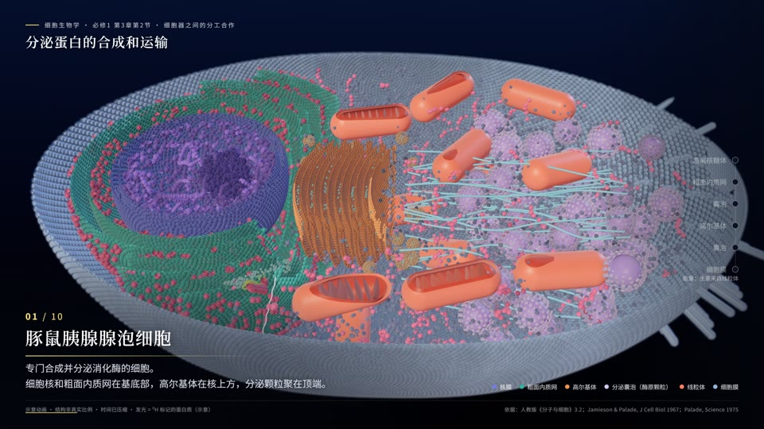
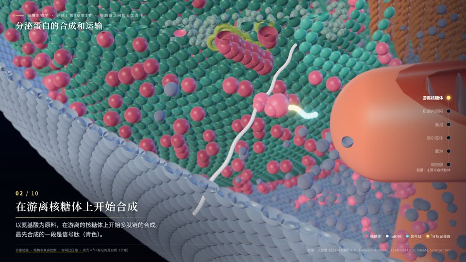
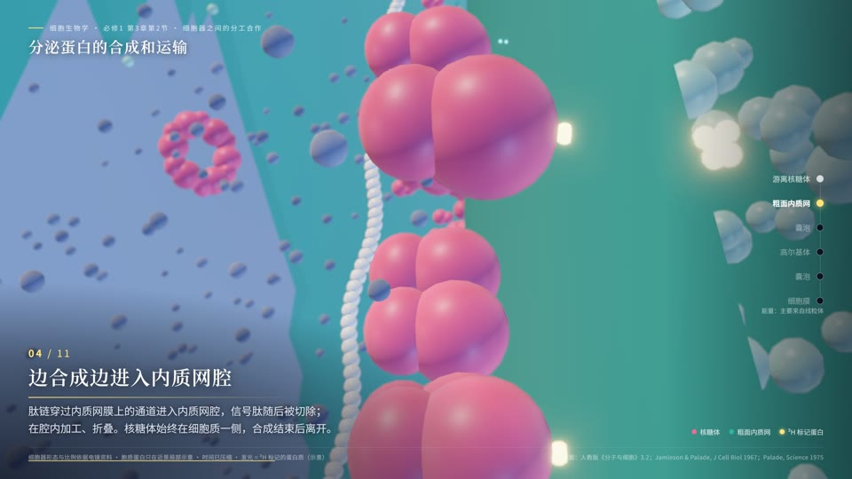
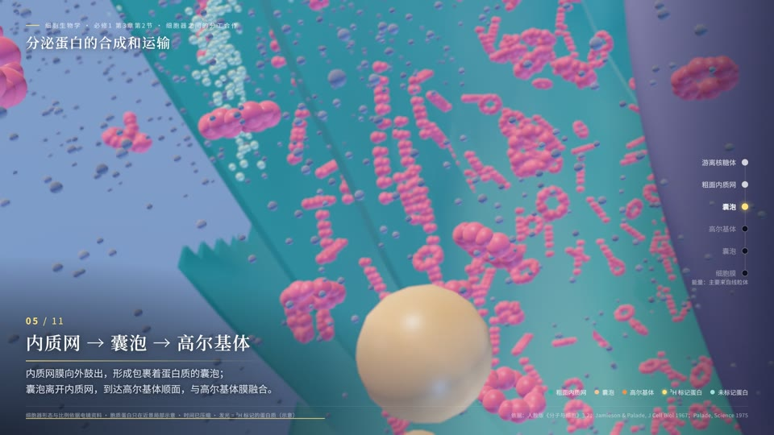
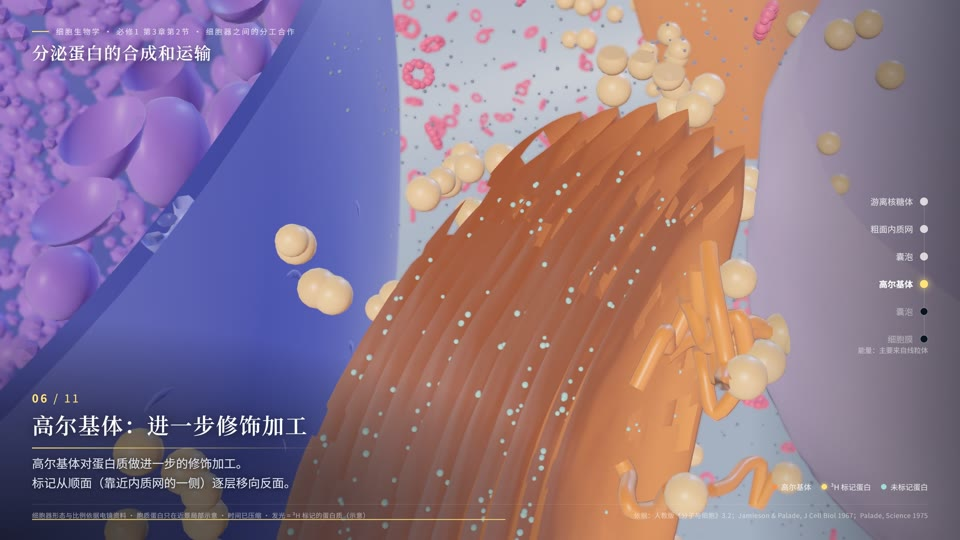
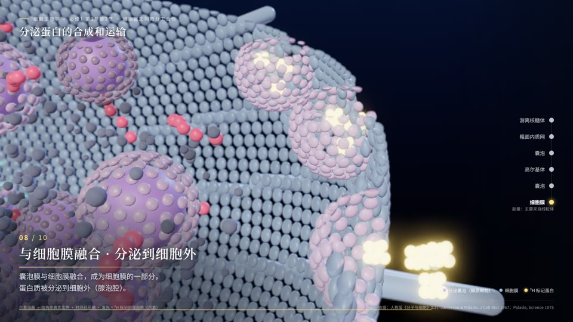
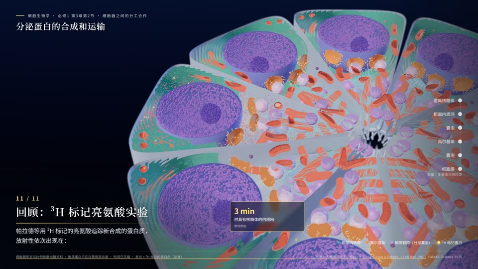

**English** · [中文](README.zh-CN.md)

# bio-viz-film

**A Claude Code skill for making professor-grade 3D biology explainer videos from code — with a built-in accuracy protocol so the animation never invents science.**


Give it a textbook section, a paper figure, or a process ("secretory pathway", "exocytosis", "viral entry"). It builds a procedural cutaway cell in three.js, animates the *real* process as a pure function of time, and records it frame-by-frame into a deterministic 1080p/4K video:

Pick a layout per video (`?layout=`):

| layout | what you get |
|---|---|
| `clean` | pure 3D footage, no page or text at all — for your own voice-over / editing |
| `lecture` (default) | dark academic layout: step number + serif title, textbook-wording captions, pathway navigator, legend, sources |
| `notes` | light "handout" layout: 3D on the left, every step listed on a paper sidebar — for courseware |
| `dashboard` | live tracking panel: how many labeled molecules sit in each compartment, counted from the model itself (and labeled as such) |
| your own | drop a `layouts/<name>.js` (meta / css / html / mount / update) and design it for the topic |

## Why another bio-viz tool

Most AI-made "science" animations look great and are quietly wrong: fake dashboards, made-up numbers, ribosomes swimming into the ER, proteins floating naked through the cytoplasm. This skill treats accuracy as the first requirement:

1. **Fact sheet first** — every caption and number gets a source (textbook section / DOI). Unverified → not on screen.
2. **Forbidden-shots list** — the known misconceptions for the topic, written down before any animation.
3. **Two independent reviews** — a fresh sub-agent plays *cell-biology professor + science-film art director*, reviews stills, captions and the process code, and must answer "usable for teaching: yes / no".
4. **Fix everything rated "error" or "misleading", re-review, then render.**

No fake data panels, no ATP laser beams, no "magic" — if a mechanism is unsettled, the film shows *where* the label is over time, not a made-up mechanism.

## Case study: the secretory pathway (high-school textbook)

People's Education Press *Biology, Compulsory 1*, §3.2 "Synthesis and transport of secretory proteins" — a guinea-pig pancreatic acinar cell and Palade's ³H-leucine pulse-chase experiment. 83 s, 10 steps.

| | |
|---|---|
|  |  |
| Polarized acinar cell, cut open | Free ribosome starts the chain; signal peptide in cyan |
|  |  |
| Chain enters the ER lumen through a channel; signal peptide cleaved | ER membrane buds a vesicle that carries the labeled cohort |
|  |  |
| Label moves cis → trans through the Golgi | Ω-shaped fusion pore at the apical membrane, contents released |


*Replay of the pulse-chase: label appears in the RER (3 min) → Golgi (17 min) → apical vesicles & outside (117 min), textbook data.*

- 🎬 Videos (720p, in repo): [lecture](examples/secretion/media/secretion_lecture_720p.mp4) · [clean](examples/secretion/media/secretion_clean_720p.mp4)
- 🎞 Full 1080p60 masters: see **Releases**
- 🔍 Honest self-audit of organelle shapes + comparison with a viral cell video: [`examples/secretion/形态核查与对标对比.md`](examples/secretion/形态核查与对标对比.md) (Chinese)
- 📝 The three review rounds that shaped it: [`examples/secretion/`](examples/secretion/) (in Chinese) — round 1 caught fabricated dashboard data and wrong organelle anatomy in the first prototype; round 2 caught label non-conservation and missing membrane dynamics; round 3 verdict: *usable for teaching with minor fixes* (both fixed before rendering).

What the animation gets right (and what the reviews enforced):
- the labeled protein is **conserved** — a cohort of 12 molecules, each traceable in every frame
- after entering the ER, cargo is **always inside a lumen or a vesicle**
- budding and fusion are **membrane events** (buds grow out of the membrane; an Ω-shaped pore opens and the vesicle membrane merges into the plasma membrane)
- the ribosome stays on the **cytosolic side**; secretion is **apical only**; Golgi **in at cis, out at trans**
- mitochondria have a double membrane with cristae **inside**

## How it works

```
template/site2/
  scene-*.js   procedural structures (instanced beads, seeded RNG, baked AO) + update(t, T): the process as a pure function of t
  story-*.js   steps, camera moves, captions, legend, sources, process time windows
  engine.js    renderer (bloom, depth of field, ACES), camera timeline, lecture overlay
  index.html   lecture layout
template/tools/
  record.mjs   deterministic frame recorder (headless Chrome → ffmpeg), supersampling via --dpr 2 --scale
  sheet2.py    contact sheets for review · probe.mjs / hidetest.mjs  debug artifacts by ray-casting / hiding objects
references/    accuracy-protocol · techniques · new-scene guide · science checklist · pitfalls · research landscape
```

New topic = usually a new `story-*.js`; new organism/organelle = a new `scene-*.js` following the same interface.

## Install & run

```bash
# as a Claude Code skill
git clone https://github.com/moluyao/bio-viz-film ~/.claude/skills/bio-viz-film

# render the example (needs Chrome + ffmpeg)
cd ~/.claude/skills/bio-viz-film/template/tools && npm install
cd .. 
node tools/record.mjs site2 out/lecture.mp4 --size 1920x1080 --dpr 2 --scale 1920x1080
node tools/record.mjs site2 out/clean.mp4   --size 1920x1080 --dpr 2 --scale 1920x1080 --query layout=clean
# preview live: serve template/site2 with any static server and open index.html (space = pause)
```

Then just ask Claude: *"Turn textbook section X into a 3D explainer"*, *"animate viral entry for my thesis defense"*, *"make a clean 3D clip of exocytosis"*.

The skill's working docs (`SKILL.md`, `references/`) are written in Chinese; Claude reads them fine in any language and will answer in yours.

## Honest limits

- Procedural, **schematic** models — not molecular structures. Sizes keep only their relative order and the film says *"not to scale"*. For real PDB/cryo-EM structures use Molecular Nodes, Mol\* or ChimeraX (see `references/techniques.md`).
- Reviews are done by AI sub-agents against cited sources; they catch a lot, but for publication-grade material have a domain expert sign off.
- Rendering is offline (≈15–20 min for 83 s at 2× supersampled 1080p60 on a consumer GPU).

## License

MIT for this skill. three.js (vendored, `template/site2/vendor`) is MIT — see `THREE_LICENSE`. Textbook wording is quoted for educational use; sources are cited on screen.
