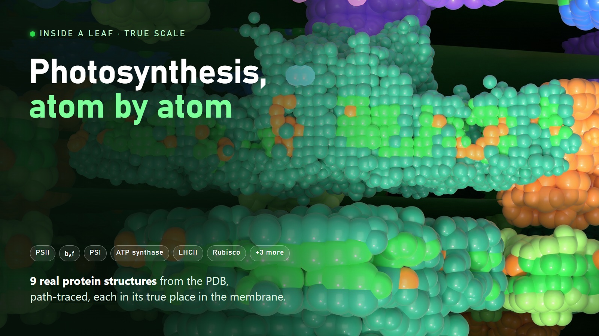
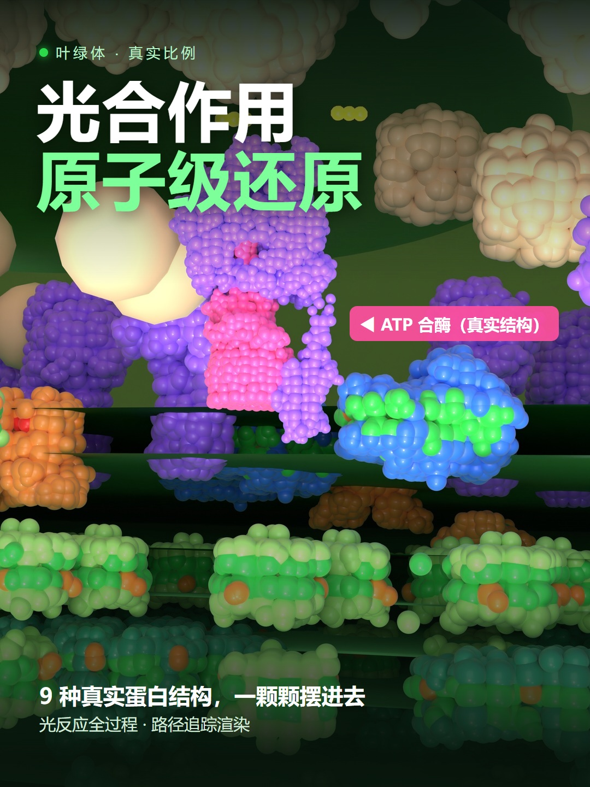
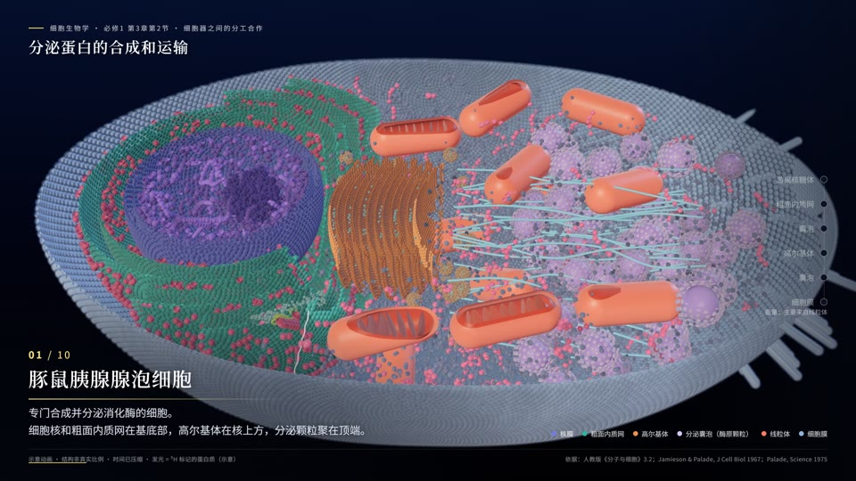
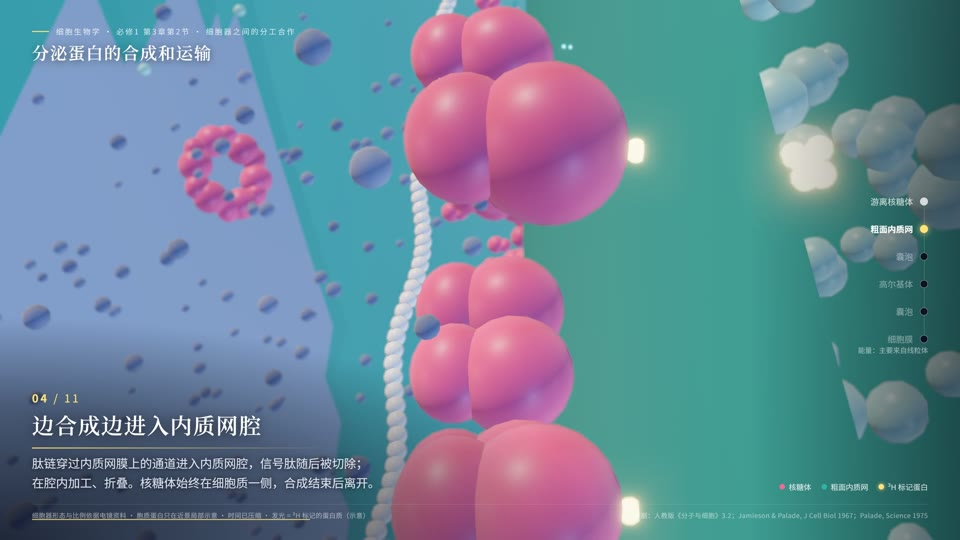
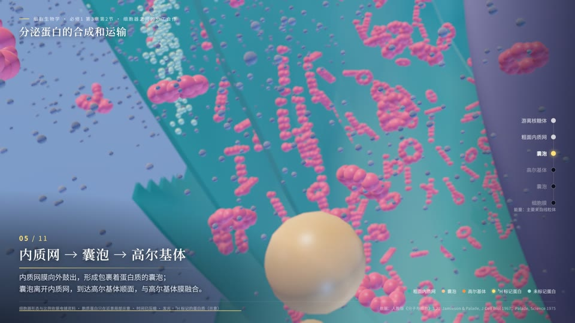
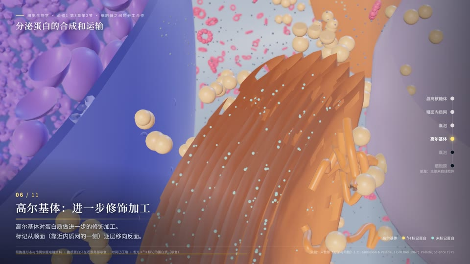
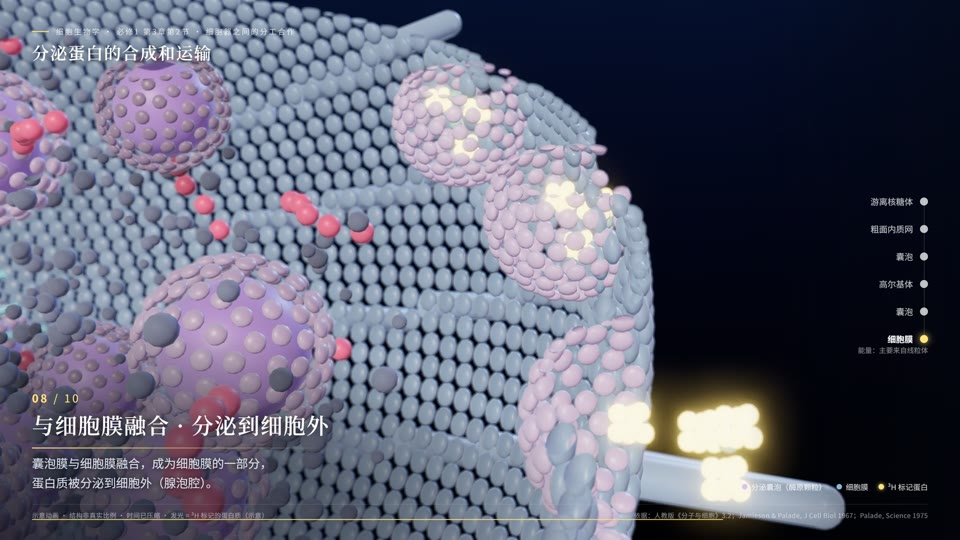

[English](README.md) · **中文**

# bio-viz-film

**一个 Claude Code skill：用代码做教授级的生物 3D 讲解视频，自带准确性审查流程，动画里不编造科学。**


给它一节课本、一张论文模型图，或一个生物过程（如"分泌蛋白的运输""胞吐""病毒入侵"），它会做三件事：
1. 用 three.js 程序化搭一个剖开的细胞；
2. 把**真实的过程**写成时间 t 的纯函数来驱动动画；
3. 逐帧确定性录制成 1080p 或 4K 视频。

## 版式可选（带网页 / 不带网页 / 按要求定制）

| `?layout=` | 效果 |
|---|---|
| `clean` | **纯 3D 画面**，没有任何网页或文字，方便二次剪辑、配音 |
| `lecture`（默认） | 深色学术讲解版：步骤序号 + 衬线标题 + 课本原句、通路导航、图例、出处 |
| `reel` | 炫片版：每步一句大字钩子，配图例和"伪彩"标签，适合竖版信息流 |
| `notes` | 浅色讲义版：左边 3D 画面，右边纸面列出全部步骤，适合课件和上课投屏 |
| `dashboard` | 追踪仪表盘：实时显示标记分子在各区室的个数。数字来自模型本身，画面上注明不是实验值 |
| 自定义 | 在 `layouts/` 里新写一个版式文件，按主题或按要求设计 |

## v4：真实蛋白结构 + 两条出片路线（新）

<p> </p>

新案例：**类囊体膜上的光反应**（人教版必修1 5.4 光合作用，画面文字为英文）。

| | |
|---|---|
| 专业路线（Blender Cycles 路径追踪） | [`thylakoid_pro_720p.mp4`](examples/thylakoid/media/thylakoid_pro_720p.mp4) |
| 快速路线 vs 专业路线 左右对比 | [`thylakoid_quick_vs_pro_720p.mp4`](examples/thylakoid/media/thylakoid_quick_vs_pro_720p.mp4) |
| 1080p 原片（带配乐） | [Release v4.0](https://github.com/moluyao/bio-viz-film/releases/tag/v4.0) |

- **每个蛋白都是真实的原子结构**：`tools/pdb2beads.py` 从 RCSB 下载结构（膜蛋白用 **OPM** 数据库里已经定好方向的版本），聚成 0.6 / 1.4 nm 的珠子，叶绿素、类胡萝卜素、金属簇按类别上色。它还导出关键位点（Mn 簇、醌位点、血红素、Fe–S 簇），过程动画就从这些真实位置出发。片中共 9 种结构：PSII–LHCII、b₆f、PSI、ATP 合酶（标出转子链，c₁₄ 环真的会转）、LHCII、质体蓝素、铁氧还蛋白、FNR、Rubisco。
- **0 穿模**：摆放时逐颗珠子做碰撞检测，`tools/check.mjs` 再复查一遍（2,459 个分子，重叠 0 对）。
- **同一场景，两条路线出片**：
  - **快速路线**：three.js + N8AO 环境光遮蔽，49 秒的片子约 15 分钟出完。
  - **专业路线**：先用 `export_blender.mjs` 导出场景，再用 `blender_build.py` 在 Blender 里用几何节点和 Cycles 点云重建，GPU 路径追踪加 GPU 降噪，最后把网页界面叠回去（`record.mjs --overlay-dir`）。调优后（只用 GPU、降噪也放 GPU）笔记本核显约 4 秒一帧，详见 `references/two-routes.md`。
- **新版式 `bench`**：浅色"实验台"网页，包括带框的 3D 窗口、钉在 3D 结构上的准星标注、由相机实时算出的比例尺、模型计数，以及标了 MODEL / TYPICAL / TEXTBOOK 来源的小卡片。
- **科学审查**：独立审查指出计数前后矛盾、pH 变化时机不对，都已改正。现在计数按产生 1 个 O₂ 的化学计量走：8 个光子、4 个电子、12 个 H⁺、2 个 NADPH、约 2.6 个 ATP。
- 另外新增：
  - 化学突触案例（`scene-synapse.js`，bench 版式）；
  - 按画面节点合成的原创配乐（`tools/bgm_*.py`）；
  - NPU（OpenVINO）AI 补帧可行性测试：能跑，但画质不达标，未采用。

## v3：真实比例 + 炫片模式

- **细胞器不简化**：所有结构都按电镜资料的真实形态和比例建模（1 单位 = 0.5 µm），尺寸表见 `references/morphology-acinar.md`，包括：
  - 锥形腺泡细胞围成腺泡；
  - 16 层平行的粗面内质网，布满 25 nm 的核糖体；
  - 6 层扁囊的高尔基体，边缘膨大、有窗孔；
  - Ø 约 1.5 µm 的浓缩泡浓缩成 Ø 约 0.9 µm 的酶原颗粒；
  - 带嵴的线粒体，100 nm 的微绒毛。

  从细胞到分子跨三个数量级，靠相机连续推近来呈现，不缩放结构。
- **炫片模式**：同样的科学内容，换成能抓住眼球的展示方式。参数如下，也可以直接说"给我出一条明亮、炸一点的竖版短片"：
  - `look=` 风格：vivid 明亮 · neon 霓虹 · academic 学术 · paper 纸面
  - `palette=` 配色：candy 糖果 · sunset 日落 · neon 霓虹 · textbook 教学
  - `fx=channels`：像素扫描换色转场
  - `layout=reel`：每步一句大字钩子，配图例和"伪彩，非显微成像"标签
  - 竖版 1080×1920
- **审查**：目前做了五轮独立审查。讲解版的结论是"可用于教学"；炫片在第五轮后修好了图例撞色、胞吐镜头泛白、碎片漂出细胞三个问题。

## 为什么要做这个

很多 AI 生成的"科学动画"好看，但悄悄出错：假仪表盘、编出来的数字、核糖体钻进内质网、蛋白质在细胞质里裸漂。这个 skill 把准确性放在第一位：

1. **先写事实表**：每句字幕、每个数字都要有出处（课本章节或 DOI），查不到出处就不上屏。
2. **先列"禁止画面"**：动画开工前，先写下这个主题的常见错误。
3. **两轮独立审查**：起一个全新的子智能体，扮演"细胞生物学教授 + 科普片美术总监"，审样张、字幕和过程代码，必须回答"能否直接用于教学"。
4. **改完所有"错误/误导"级问题，复审通过，再出片。**

机制尚无定论的地方，画面只表现"标记在哪里"，不编一个机制出来。

## 案例：分泌蛋白的合成和运输（人教版必修1 第3章第2节）

案例是豚鼠胰腺腺泡细胞，结尾回顾帕拉德的 ³H 标记亮氨酸实验。讲解版 87 秒、11 步，另有 37 秒炫片竖版。

| | |
|---|---|
|  |  |
| 真实的腺泡：约 9 个锥形细胞围着中央腺泡腔 | 游离核糖体开始合成，青色的一段是信号肽 |
|  |  |
| 肽链经通道进入粗面内质网腔 | 囊泡从内质网出口驶向高尔基体顺面 |
|  |  |
| 标记在 6 层扁囊的高尔基体中从顺面移向反面 | 酶原颗粒移向顶端细胞膜 |

- 🎬 视频（仓库内 720p）：[讲解版](examples/secretion/media/secretion_lecture_720p.mp4) · [炫片竖版](examples/secretion/media/secretion_showreel_720p.mp4)
- 🎞 1080p60 原片：见 **Releases**
- 📝 审查记录：[`examples/secretion/`](examples/secretion/)
  - 第一轮：在早期原型里查出编造的仪表盘数据和错误的细胞器结构；
  - 第二轮：查出标记蛋白不守恒、膜不动；
  - 第三轮：结论是"可用于教学，需小修"，小修已在出片前完成；
  - 另有[形态核查与对比](examples/secretion/形态核查与对标对比.md)，如实列出了还不够好的地方。

## 安装与运行

```bash
git clone https://github.com/moluyao/bio-viz-film ~/.claude/skills/bio-viz-film
cd ~/.claude/skills/bio-viz-film/template/tools && npm install   # 需要 Chrome 和 ffmpeg
cd ..
node tools/record.mjs site2 out/lecture.mp4 --size 1920x1080 --dpr 2 --scale 1920x1080
node tools/record.mjs site2 out/clean.mp4   --size 1920x1080 --dpr 2 --scale 1920x1080 --query layout=clean
node tools/record.mjs site2 out/notes.mp4   --size 1920x1080 --dpr 2 --scale 1920x1080 --query layout=notes
```

装好后，直接对 Claude 说：
- "把这一节课本做成 3D 讲解动画"
- "做一个病毒入侵的动画，答辩用"
- "出一条不带文字的胞吐 3D 片段"

## 局限（如实说明）

- **只是示意模型**：模型是程序化生成的，不是真实的分子结构。尺寸只保留相对大小顺序，画面上会写明"非真实比例"。需要真实结构时，请用 Molecular Nodes、Mol\* 或 ChimeraX。
- **审查不能代替专家**：审查由 AI 子智能体对照出处完成，能抓出很多问题；正式出版的内容，请再请领域专家把关。
- **离线渲染**：83 秒的片子在消费级显卡上大约要渲染 20 分钟。

## 许可

本 skill 采用 MIT 许可；内置的 three.js 也是 MIT。字幕中的课本原句仅用于教学引用，画面上注明了出处。
