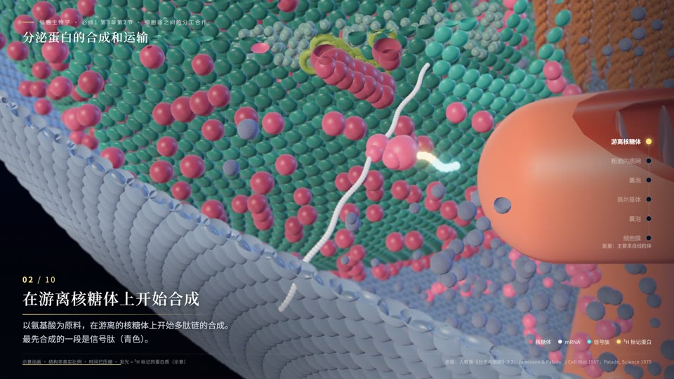

[English](README.md) · **中文**

# bio-viz-film

**一个 Claude Code skill：用代码做教授级的生物 3D 讲解视频，自带准确性审查流程，动画里不编造科学。**


给它一节课本、一张论文模型图，或一个生物过程（如"分泌蛋白的运输""胞吐""病毒入侵"），它会做三件事：
1. 用 three.js 程序化搭一个剖开的细胞；
2. 把**真实的过程**写成时间 t 的纯函数来驱动动画；
3. 逐帧确定性录制成 1080p 或 4K 视频。

## 版式可选（带网页 / 不带网页 / 按要求定制）

| `?layout=` | 效果 |
|---|---|
| `clean` | **纯 3D 画面**，没有任何网页或文字，方便二次剪辑、配音 |
| `lecture`（默认） | 深色学术讲解版：步骤序号 + 衬线标题 + 课本原句、通路导航、图例、出处 |
| `notes` | 浅色讲义版：左边 3D 画面，右边纸面列出全部步骤，适合课件和上课投屏 |
| `dashboard` | 追踪仪表盘：实时显示标记分子在各区室的个数。数字来自模型本身，画面上注明不是实验值 |
| 自定义 | 在 `layouts/` 里新写一个版式文件，按主题或按要求设计 |

## 为什么要做这个

很多 AI 生成的"科学动画"好看，但悄悄出错：假仪表盘、编出来的数字、核糖体钻进内质网、蛋白质在细胞质里裸漂。这个 skill 把准确性放在第一位：

1. **先写事实表**：每句字幕、每个数字都要有出处（课本章节或 DOI），查不到出处就不上屏。
2. **先列"禁止画面"**：动画开工前，先写下这个主题的常见错误。
3. **两轮独立审查**：起一个全新的子智能体，扮演"细胞生物学教授 + 科普片美术总监"，审样张、字幕和过程代码，必须回答"能否直接用于教学"。
4. **改完所有"错误/误导"级问题，复审通过，再出片。**

机制尚无定论的地方，画面只表现"标记在哪里"，不编一个机制出来。

## 案例：分泌蛋白的合成和运输（人教版必修1 第3章第2节）

案例是豚鼠胰腺腺泡细胞，结尾回顾帕拉德的 ³H 标记亮氨酸实验。全片 83 秒，分 10 步。

| | |
|---|---|
|  |  |
| 剖开的极性腺泡细胞 | 游离核糖体开始合成，青色的一段是信号肽 |
|  |  |
| 肽链经通道进入内质网腔，信号肽被切除 | 内质网膜鼓出囊泡，带走一批标记蛋白 |
|  |  |
| 标记从高尔基体顺面移向反面 | 顶端细胞膜出现 Ω 形融合孔，内容物被释放 |

- 🎬 视频（仓库内 720p）：[讲解版](examples/secretion/media/secretion_lecture_720p.mp4) · [纯画面版](examples/secretion/media/secretion_clean_720p.mp4)
- 🎞 1080p60 原片：见 **Releases**
- 📝 审查记录：[`examples/secretion/`](examples/secretion/)
  - 第一轮：在早期原型里查出编造的仪表盘数据和错误的细胞器结构；
  - 第二轮：查出标记蛋白不守恒、膜不动；
  - 第三轮：结论是"可用于教学，需小修"，小修已在出片前完成；
  - 另有[形态核查与对比](examples/secretion/形态核查与对标对比.md)，如实列出了还不够好的地方。

## 安装与运行

```bash
git clone https://github.com/moluyao/bio-viz-film ~/.claude/skills/bio-viz-film
cd ~/.claude/skills/bio-viz-film/template/tools && npm install   # 需要 Chrome 和 ffmpeg
cd ..
node tools/record.mjs site2 out/lecture.mp4 --size 1920x1080 --dpr 2 --scale 1920x1080
node tools/record.mjs site2 out/clean.mp4   --size 1920x1080 --dpr 2 --scale 1920x1080 --query layout=clean
node tools/record.mjs site2 out/notes.mp4   --size 1920x1080 --dpr 2 --scale 1920x1080 --query layout=notes
```

装好后，直接对 Claude 说：
- "把这一节课本做成 3D 讲解动画"
- "做一个病毒入侵的动画，答辩用"
- "出一条不带文字的胞吐 3D 片段"

## 局限（如实说明）

- **只是示意模型**：模型是程序化生成的，不是真实的分子结构。尺寸只保留相对大小顺序，画面上会写明"非真实比例"。需要真实结构时，请用 Molecular Nodes、Mol\* 或 ChimeraX。
- **审查不能代替专家**：审查由 AI 子智能体对照出处完成，能抓出很多问题；正式出版的内容，请再请领域专家把关。
- **离线渲染**：83 秒的片子在消费级显卡上大约要渲染 20 分钟。

## 许可

本 skill 采用 MIT 许可；内置的 three.js 也是 MIT。字幕中的课本原句仅用于教学引用，画面上注明了出处。
